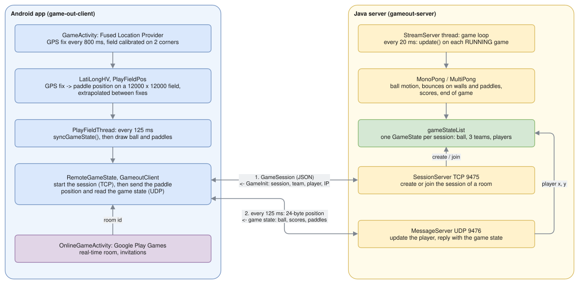

<div align="center">

# GameOutServer

**Serveur de jeu de GameOut, un Pong qui se joue en plein air : chaque joueur déplace sa raquette en marchant, suivi par le GPS d'un téléphone Android (2015-2016).**

[](src/com/gameout)
[](#procédure-de-déploiement)
[](lib)
[](#protocole)
[](#équipe)
[](https://github.com/erwan-rouzel/game-out-client)

[English](README.md) · **Français**

</div>

## Sommaire

- [Présentation](#présentation)
- [Fonctionnalités](#fonctionnalités)
- [Fonctionnement](#fonctionnement)
- [Technologies](#technologies)
- [Procédure de déploiement](#procédure-de-déploiement)
- [Contenu du dépôt](#contenu-du-dépôt)
- [Visite du code](#visite-du-code)
- [Équipe](#équipe)
- [Licence](#licence)

## Présentation

Partie réseau pour game out.

GameOut est un jeu de plein air « mixing the fun of mobile games, retro gaming and fitness activity » (selon le
[`GameActivity.java`](https://github.com/erwan-rouzel/game-out-client/blob/demo-presentation/app/src/main/java/fr/ecp/sio/gameout/GameActivity.java#L56-L62)
du client). Le terrain est une vraie surface, calibrée avec le GPS du téléphone, et la raquette de chaque joueur
suit le joueur quand il marche. Ce dépôt contient le serveur, écrit en Java sans framework : il crée les parties,
calcule la physique de la balle et synchronise tous les téléphones. L'application Android est dans
**[game-out-client](https://github.com/erwan-rouzel/game-out-client)**.

C'était un projet d'équipe : la [page de crédits](https://github.com/erwan-rouzel/game-out-client/blob/demo-presentation/app/src/main/res/raw/credits.html)
du client le décrit comme un POC mêlant cloud computing et application mobile, réalisé par une équipe de quatre
étudiants.

## Fonctionnalités

- **Serveur de sessions (TCP)** : un téléphone envoie sa session de jeu en JSON ; le premier téléphone d'un salon
  crée la partie, les suivants la rejoignent. La réponse donne l'identifiant de session, l'équipe et le numéro du
  joueur, et l'adresse du serveur.
- **Échange des positions (UDP)** : chaque téléphone envoie la position de sa raquette dans un message binaire de
  24 octets et reçoit en réponse l'état complet de la partie.
- **Boucle de jeu côté serveur** : toutes les 20 ms, chaque partie en cours déplace la balle, gère les rebonds et
  met à jour les scores.
- **Deux modes de jeu** : `MonoPong`, une équipe contre les murs sur une série de balles, et `MultiPong`, un joueur
  en haut contre un joueur en bas, en 5 points.
- **Jusqu'à trois équipes** dans l'état de la partie, avec un nombre quelconque de joueurs par équipe.
- **Plusieurs parties en même temps**, rangées dans une table concurrente indexée par identifiant de session.

## Fonctionnement

### Client et serveur

<picture>
  <source media="(prefers-color-scheme: dark)" srcset="docs/diagrams/client-server.dark.svg">
  
</picture>

<sub>Schéma en anglais, commun aux deux dépôts.</sub>

[`GameoutServer.main`](src/com/gameout/network/GameoutServer.java#L90-L95) lance trois threads :

| Thread | Port | Rôle |
|---|---|---|
| [`SessionServer`](src/com/gameout/network/SessionServer.java) | 9475 TCP | Lit une `GameSession` en JSON, crée ou rejoint la partie du salon, répond par un `GameInit` en JSON. |
| [`MessageServer`](src/com/gameout/network/MessageServer.java) | 9476 UDP | Lit la position d'un joueur, l'enregistre dans l'état de la partie, répond avec l'état de la partie encodé. |
| [`StreamServer`](src/com/gameout/network/StreamServer.java) | 9500 | Boucle de jeu : appelle `update()` sur chaque partie en cours toutes les 20 ms. |

Les parties sont rangées dans une `ConcurrentHashMap<Integer, GameState>` statique partagée par les trois threads.
Le téléphone qui crée un salon reçoit l'équipe 0, joueur 0 ; un téléphone qui rejoint un salon existant reçoit
l'équipe 1, joueur 0.

### Protocole

Tous les nombres sont en big-endian (par défaut de `java.nio.ByteBuffer`). Les coordonnées sont exprimées dans un
terrain virtuel de 12000 x 12000 ([`HVPoint.WIDTH_REF`](src/com/gameout/model/HVPoint.java#L12)).

**1. Début de session, TCP 9475.** Le téléphone envoie une `GameSession` en JSON (`id`, `roomId`, `timestamp`,
`gameType`, `serverHostName`, `numberOfPlayersInTeam1..3`). Le serveur répond par un `GameInit` en JSON : `roomId`,
`serverHostName`, `sessionId`, `teamId`, `playerId`.

**2. Joueur vers serveur, UDP 9476** (24 octets, décodés par
[`processMessageFromPlayer`](src/com/gameout/network/GameoutServerHelper.java#L123)) :

| Octets | Champ |
|---|---|
| 0-3 | identifiant de session (`int`) |
| 4-11 | horodatage (`long`) |
| 12 | identifiant d'équipe |
| 13 | identifiant du joueur dans l'équipe |
| 14 | action |
| 15 | incrément |
| 16-23 | raquette x, y, vx, vy (4 x `short`) |

**3. Serveur vers joueur, réponse UDP** (construite par
[`getGameStateMessage`](src/com/gameout/network/GameoutServerHelper.java#L18)) :

| Octets | Champ |
|---|---|
| 0-7 | horodatage (`long`) |
| 8 | état de la partie : 0 initialisation, 1 en cours, 2 terminée |
| 9 | incrément |
| 10-12 | scores des équipes 1, 2 et 3 |
| 13-20 | balle x, y, vx, vy (4 x `short`) |
| 21-23 | nombre de joueurs des équipes 1, 2 et 3 |
| puis 9 octets par joueur | x, y, vx, vy (4 x `short`), état |

Les commentaires de [`GameoutServer.java`](src/com/gameout/network/GameoutServer.java#L11-L89) contiennent une
version antérieure de ce protocole.

### Logique de jeu

Le type de jeu envoyé par le téléphone choisit les règles via
[`GameLogicManager`](src/com/gameout/game/GameLogicManager.java) :

- [`MonoPong`](src/com/gameout/game/MonoPong.java) : la balle rebondit sur les murs gauche, droit et haut et sur les
  raquettes de l'équipe 0. Chaque renvoi marque un point. Quand la balle passe en bas, le score est recopié dans
  l'équipe 1 (le meilleur score, selon les commentaires), l'équipe 0 repart de zéro et une nouvelle balle est mise
  en jeu ; la partie s'arrête quand le
  compteur de balles atteint `MAX_NUM_BALLS`.
- [`MultiPong`](src/com/gameout/game/MultiPong.java) : une raquette en bas (équipe 0) et une en haut (équipe 1) ; un
  joueur marque quand la balle passe derrière l'autre, et la partie s'arrête à 5 points.

Chaque nouvelle balle part du centre avec une vitesse aléatoire
([`Ball.initSpeed`](src/com/gameout/model/Ball.java#L28)) ; à chaque renvoi, la vitesse de la raquette modifie celle
de la balle, avec un facteur aléatoire ([`Ball.updateSpeed`](src/com/gameout/model/Ball.java#L23)).

### Adresse du serveur

L'adresse renvoyée aux téléphones dans le `GameInit` est fixée dans
[`SessionServer`](src/com/gameout/network/SessionServer.java#L100), et le client en a sa propre copie dans son
`GameoutClient` : les deux sont à mettre à la nouvelle adresse quand le serveur est déployé ailleurs.

## Technologies

| Partie | Technologie |
|---|---|
| Langage | Java, JDK 1.8 (cité par la procédure de déploiement ; le code utilise `Long.BYTES`, apparu en Java 8) |
| Réseau | sockets `java.net` : `ServerSocket` (TCP), `DatagramSocket` (UDP) |
| JSON | [Gson](https://github.com/google/gson), `lib/gson-2.4.jar` |
| Construction | artefact IntelliJ IDEA (pas de fichier Maven ni Gradle) |
| Hébergement | instance AWS EC2, d'après la procédure de déploiement |

## Procédure de déploiement

1) Créer une instance en autorisant les ports suivants en inbound / outbound :
9475 (TCP)
9476 (UDP)
9500 (UDP)

2) Installer la JVM (dernière version du JDK, a priori la 1.8) sur l'instance créée.

3) Dans IntelliJ, créer le fichier .jar qui contient l'ensemble du code compilé. Pour cela aller dans le menu "Build", puis faire "Build artifacts...". Cela ouvre un petit menu contextuel dans l'éditeur, sélectionner "Build" dans ce menu.

Cela crée un fichier .jar qui se trouve à cet endroit :

```bash
out/artifacts/GameoutServer/GameoutServer.jar
```

4) Il suffit alors de copier ce fichier sur le serveur où l'on souhaite déployer, du type :

```bash
scp out/artifacts/GameoutServer/GameoutServer.jar <login>@<ip_instance_aws>:/home/<login>/gameout/
```

5) Puis lancer le jar en se connectant au serveur de cette façon (le nohup sert à garder le serveur lancé même après déconnexion du serveur)  :

```bash
ssh <login>@<ip_instance_aws>
cd /home/<login>/gameout/
nohup java -jar GameoutServer.jar &
```

6) Pour suivre le log du serveur :

```bash
tail -f nohup.out
```

7) Il reste alors à changer l'IP côté Android en mettant la nouvelle IP de l'instance.
Et voilà en principe ça fonctionne !

### Remarques sur la construction

- Il n'y a pas de script de construction : le jar est défini comme artefact IntelliJ dans
  [`.idea/artifacts/GameoutServer.xml`](.idea/artifacts/GameoutServer.xml). Le projet IntelliJ fait référence à
  Gson 2.5 depuis le dépôt Maven, alors que le dépôt contient `lib/gson-2.4.jar` et que le manifeste du jar
  ([`META-INF/MANIFEST.MF`](META-INF/MANIFEST.MF)) met `gson-2.4.jar` dans le class path.
- [`server_aws_ec2_script.sh`](server_aws_ec2_script.sh) ne contient qu'une étape : `sudo yum install jdk`.
- [`TestClient`](src/com/gameout/network/TestClient.java) est un petit client en ligne de commande qui envoie au
  serveur deux messages de session et trois messages UDP.

## Contenu du dépôt

```
.
├── src/com/gameout/
│   ├── network/                  point d'entrée, serveurs TCP et UDP, messages binaires, journal
│   ├── game/                     règles du jeu : MonoPong, MultiPong
│   ├── model/                    GameState, Ball, Team, Player, GameSession, GameInit
│   ├── exception/                MalformedPlayerMessageException
│   └── utils/                    conversions d'octets, nombres aléatoires
├── lib/gson-2.4.jar              bibliothèque Gson (tierce)
├── META-INF/MANIFEST.MF          classe principale et class path du jar
├── .idea/, GameoutServer.iml     projet IntelliJ IDEA, avec l'artefact jar
├── server_aws_ec2_script.sh      installation du JDK sur l'instance EC2
├── docs/
│   ├── diagrams/                 source draw.io et ses exports SVG (clair et sombre)
│   └── export-diagrams.sh
├── README.md                     version anglaise
└── LISEZMOI.md                   ce fichier, avec le README d'origine
```

## Visite du code

| Partie | Où |
|---|---|
| Point d'entrée, les trois threads | [`GameoutServer.main`](src/com/gameout/network/GameoutServer.java#L90) |
| Création d'une session et arrivée d'un joueur | [`SessionServer.startGame`](src/com/gameout/network/SessionServer.java#L81) |
| Réception et réponse UDP | [`MessageServer`](src/com/gameout/network/MessageServer.java#L38) |
| Encodage et décodage binaires | [`GameoutServerHelper`](src/com/gameout/network/GameoutServerHelper.java) |
| Boucle de jeu, toutes les 20 ms | [`StreamServer`](src/com/gameout/network/StreamServer.java#L26) |
| Règles | [`MonoPong.update`](src/com/gameout/game/MonoPong.java#L20), [`MultiPong.update`](src/com/gameout/game/MultiPong.java#L13) |
| État de la partie | [`GameState`](src/com/gameout/model/GameState.java), [`Ball`](src/com/gameout/model/Ball.java) |

## Équipe

GameOut a été réalisé en équipe. Auteurs des commits de ce dépôt, par identifiant GitHub :

- [erwan-rouzel](https://github.com/erwan-rouzel) (aussi sous le nom `erouzel`) : code du serveur et procédure de
  déploiement. Le code du client cite Erwan Rouzel pour « Server and cloud computing ».
- [odeste](https://github.com/odeste) : commit initial. Le code du client cite Olivier Desté pour « intial idea
  and Android dev ».
- [cquenum](https://github.com/cquenum) : `server_aws_ec2_script.sh`. Le code du client cite Codjo Quenum pour
  « Google Play, advertisement funding ».

[abdelhafiz23](https://github.com/abdelhafiz23) a aussi contribué au
[client](https://github.com/erwan-rouzel/game-out-client#team). Les dépôts étaient d'abord hébergés sous le compte
`odeste` (`odeste/GameoutServer`, d'après les commits de fusion).

## Licence

Pas de fichier de licence : c'était un projet d'équipe. La bibliothèque Gson de [`lib/`](lib) est un composant
tiers soumis à sa propre licence.
