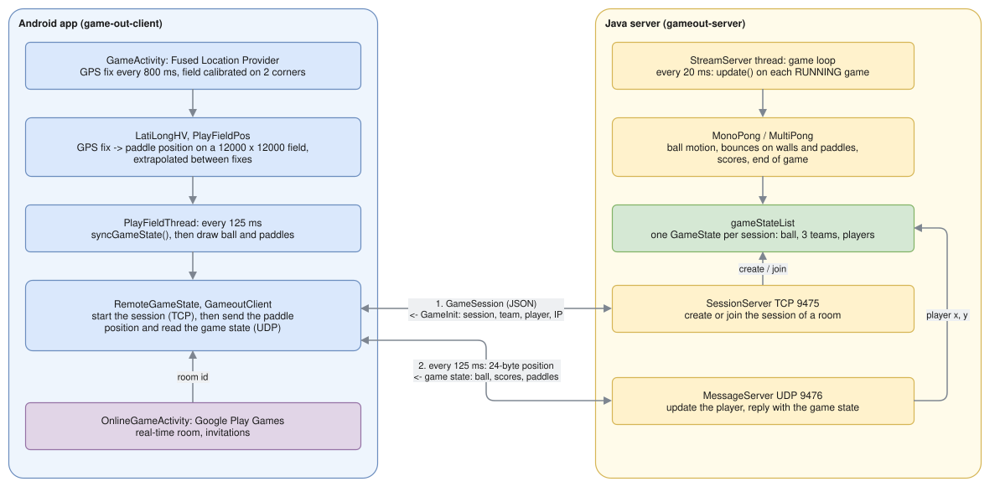

<div align="center">

# GameOutServer

**Game server of GameOut, a Pong game played outdoors: each player moves their paddle by walking, tracked by the GPS of an Android phone (2015-2016).**

[](src/com/gameout)
[](#deployment-procedure)
[](lib)
[](#protocol)
[](#team)
[](https://github.com/erwan-rouzel/game-out-client)

**English** · [Français](LISEZMOI.md)

</div>

## Table of contents

- [About](#about)
- [Features](#features)
- [How it works](#how-it-works)
- [Tech stack](#tech-stack)
- [Deployment procedure](#deployment-procedure)
- [Repository layout](#repository-layout)
- [Code tour](#code-tour)
- [Team](#team)
- [License](#license)

## About

> *The original README of this repository is in French. It is kept word for word in [LISEZMOI.md](LISEZMOI.md);
> the sections below that come from it are English translations.*

Network part for game out.

GameOut is an outdoor game "mixing the fun of mobile games, retro gaming and fitness activity" (as described in the
client's [`GameActivity.java`](https://github.com/erwan-rouzel/game-out-client/blob/demo-presentation/app/src/main/java/fr/ecp/sio/gameout/GameActivity.java#L56-L62)).
The playing field is a real area, calibrated with the GPS of the phone, and each player's paddle follows the player
as they walk. This repository holds the server, written in plain Java with no framework: it creates the game
sessions, runs the ball physics and keeps every phone in sync. The Android app is in
**[game-out-client](https://github.com/erwan-rouzel/game-out-client)**.

It was a team project: the client's [credits page](https://github.com/erwan-rouzel/game-out-client/blob/demo-presentation/app/src/main/res/raw/credits.html)
describes it as a proof of concept mixing cloud computing and a mobile app, built by a team of four students.

## Features

- **Session server (TCP)**: a phone sends its game session as JSON; the first phone of a room creates the game, the
  next ones join it. The reply gives the session id, the player's team and number, and the address of the server.
- **Position exchange (UDP)**: each phone sends its paddle position in a 24-byte binary message and gets the whole
  game state back in the reply.
- **Server-side game loop**: every 20 ms, each running game moves the ball, handles bounces and updates scores.
- **Two game modes**: `MonoPong`, one team against the walls over a series of balls, and `MultiPong`, one player at
  the top against one at the bottom, first to 5 points.
- **Up to three teams** in the game state, with any number of players per team.
- **Several games at once**, kept in a concurrent map indexed by session id.

## How it works

### Client and server

<picture>
  <source media="(prefers-color-scheme: dark)" srcset="docs/diagrams/client-server.dark.svg">
  
</picture>

[`GameoutServer.main`](src/com/gameout/network/GameoutServer.java#L90-L95) starts three threads:

| Thread | Port | Role |
|---|---|---|
| [`SessionServer`](src/com/gameout/network/SessionServer.java) | 9475 TCP | Reads a JSON `GameSession`, creates or joins the game of that room, replies with a JSON `GameInit`. |
| [`MessageServer`](src/com/gameout/network/MessageServer.java) | 9476 UDP | Reads a player's position, stores it in the game state, replies with the encoded game state. |
| [`StreamServer`](src/com/gameout/network/StreamServer.java) | 9500 | Game loop: calls `update()` on every running game every 20 ms. |

The games live in a static `ConcurrentHashMap<Integer, GameState>` shared by the three threads. The phone that
creates a room gets team 0, player 0; a phone joining an existing room gets team 1, player 0.

### Protocol

All numbers are big-endian (`java.nio.ByteBuffer` default). Coordinates are in a virtual 12000 x 12000 field
([`HVPoint.WIDTH_REF`](src/com/gameout/model/HVPoint.java#L12)).

**1. Session start, TCP 9475.** The phone sends a `GameSession` as JSON (`id`, `roomId`, `timestamp`, `gameType`,
`serverHostName`, `numberOfPlayersInTeam1..3`). The server answers with a `GameInit` as JSON: `roomId`,
`serverHostName`, `sessionId`, `teamId`, `playerId`.

**2. Player to server, UDP 9476** (24 bytes, decoded by
[`processMessageFromPlayer`](src/com/gameout/network/GameoutServerHelper.java#L123)):

| Bytes | Field |
|---|---|
| 0-3 | session id (`int`) |
| 4-11 | timestamp (`long`) |
| 12 | team id |
| 13 | player id in the team |
| 14 | action |
| 15 | increment |
| 16-23 | paddle x, y, vx, vy (4 x `short`) |

**3. Server to player, UDP reply** (built by
[`getGameStateMessage`](src/com/gameout/network/GameoutServerHelper.java#L18)):

| Bytes | Field |
|---|---|
| 0-7 | timestamp (`long`) |
| 8 | game status: 0 initializing, 1 running, 2 finished |
| 9 | increment |
| 10-12 | score of teams 1, 2 and 3 |
| 13-20 | ball x, y, vx, vy (4 x `short`) |
| 21-23 | number of players in teams 1, 2 and 3 |
| then, 9 bytes per player | x, y, vx, vy (4 x `short`), state |

The comments in [`GameoutServer.java`](src/com/gameout/network/GameoutServer.java#L11-L89) hold an earlier draft of
this protocol, in French.

### Game logic

The game type sent by the phone selects the rules through
[`GameLogicManager`](src/com/gameout/game/GameLogicManager.java):

- [`MonoPong`](src/com/gameout/game/MonoPong.java): the ball bounces on the left, right and top walls and on the
  paddles of team 0. Each hit scores one point. When the ball goes past the bottom, the score is copied to team 1
  (the comments call it the high score), team 0 starts again from zero and a new ball is served; the game ends once the
  ball counter reaches `MAX_NUM_BALLS`.
- [`MultiPong`](src/com/gameout/game/MultiPong.java): one paddle at the bottom (team 0) and one at the top (team 1);
  a player scores when the ball goes past the other end, and the game ends at 5 points.

Each new ball starts at the center with a random speed
([`Ball.initSpeed`](src/com/gameout/model/Ball.java#L28)); on a paddle hit, the paddle's speed changes the ball's
speed, with a random factor ([`Ball.updateSpeed`](src/com/gameout/model/Ball.java#L23)).

### Server address

The address sent back to the phones in `GameInit` is set in
[`SessionServer`](src/com/gameout/network/SessionServer.java#L100), and the client has its own copy in its
`GameoutClient`: both are to be set to the new address when the server is deployed elsewhere.

## Tech stack

| Part | Technology |
|---|---|
| Language | Java, JDK 1.8 (the deployment procedure names it; the code uses `Long.BYTES`, added in Java 8) |
| Networking | `java.net` sockets: `ServerSocket` (TCP), `DatagramSocket` (UDP) |
| JSON | [Gson](https://github.com/google/gson), `lib/gson-2.4.jar` |
| Build | IntelliJ IDEA artifact (no Maven or Gradle file) |
| Hosting | AWS EC2 instance, per the deployment procedure |

## Deployment procedure

*English translation of the original procedure (see [LISEZMOI.md](LISEZMOI.md#procédure-de-déploiement)).*

1) Create an instance, allowing the following ports inbound / outbound:
9475 (TCP)
9476 (UDP)
9500 (UDP)

2) Install the JVM (latest version of the JDK, presumably 1.8) on the instance you created.

3) In IntelliJ, create the .jar file that contains all the compiled code. To do so, go to the "Build" menu, then
"Build artifacts...". This opens a small context menu in the editor; select "Build" in this menu.

This creates a .jar file located here:

```bash
out/artifacts/GameoutServer/GameoutServer.jar
```

4) Then just copy this file to the server you want to deploy to, for example:

```bash
scp out/artifacts/GameoutServer/GameoutServer.jar <login>@<ip_instance_aws>:/home/<login>/gameout/
```

5) Then start the jar by logging in to the server like this (nohup keeps the server running even after you log out
of the server):

```bash
ssh <login>@<ip_instance_aws>
cd /home/<login>/gameout/
nohup java -jar GameoutServer.jar &
```

6) To follow the server log:

```bash
tail -f nohup.out
```

7) All that is left is to change the IP on the Android side, putting the new IP of the instance.
And there you go, in principle it works!

### Notes on building

- There is no build script: the jar is defined as an IntelliJ artifact in
  [`.idea/artifacts/GameoutServer.xml`](.idea/artifacts/GameoutServer.xml). The IntelliJ project refers to Gson 2.5
  from the Maven repository, while the repository ships `lib/gson-2.4.jar` and the jar manifest
  ([`META-INF/MANIFEST.MF`](META-INF/MANIFEST.MF)) puts `gson-2.4.jar` on the class path.
- [`server_aws_ec2_script.sh`](server_aws_ec2_script.sh) holds a single step: `sudo yum install jdk`.
- [`TestClient`](src/com/gameout/network/TestClient.java) is a small command-line client that sends two session
  messages and three UDP messages to the server.

## Repository layout

```
.
├── src/com/gameout/
│   ├── network/                  entry point, TCP and UDP servers, binary messages, logging
│   ├── game/                     game rules: MonoPong, MultiPong
│   ├── model/                    GameState, Ball, Team, Player, GameSession, GameInit
│   ├── exception/                MalformedPlayerMessageException
│   └── utils/                    byte conversions, random numbers
├── lib/gson-2.4.jar              Gson library (third party)
├── META-INF/MANIFEST.MF          main class and class path of the jar
├── .idea/, GameoutServer.iml     IntelliJ IDEA project, with the jar artifact
├── server_aws_ec2_script.sh      JDK installation on the EC2 instance
├── docs/
│   ├── diagrams/                 draw.io source and its SVG exports (light and dark)
│   └── export-diagrams.sh
├── README.md                     this file
└── LISEZMOI.md                   French version, with the original README
```

## Code tour

| Part | Where |
|---|---|
| Entry point, the three threads | [`GameoutServer.main`](src/com/gameout/network/GameoutServer.java#L90) |
| Session creation and join | [`SessionServer.startGame`](src/com/gameout/network/SessionServer.java#L81) |
| UDP receive and reply | [`MessageServer`](src/com/gameout/network/MessageServer.java#L38) |
| Binary encoding and decoding | [`GameoutServerHelper`](src/com/gameout/network/GameoutServerHelper.java) |
| Game loop, every 20 ms | [`StreamServer`](src/com/gameout/network/StreamServer.java#L26) |
| Rules | [`MonoPong.update`](src/com/gameout/game/MonoPong.java#L20), [`MultiPong.update`](src/com/gameout/game/MultiPong.java#L13) |
| Game state | [`GameState`](src/com/gameout/model/GameState.java), [`Ball`](src/com/gameout/model/Ball.java) |

## Team

GameOut was built by a team. Commit authors in this repository, by GitHub login:

- [erwan-rouzel](https://github.com/erwan-rouzel) (also committed as `erouzel`): server code and deployment
  procedure. The client's code names Erwan Rouzel for "Server and cloud computing".
- [odeste](https://github.com/odeste): initial commit. The client's code names Olivier Desté for the "intial idea
  and Android dev".
- [cquenum](https://github.com/cquenum): `server_aws_ec2_script.sh`. The client's code names Codjo Quenum for
  "Google Play, advertisement funding".

[abdelhafiz23](https://github.com/abdelhafiz23) also contributed to the
[client](https://github.com/erwan-rouzel/game-out-client#team). The repositories were first hosted under the
`odeste` account (`odeste/GameoutServer`, as the merge commits show).

## License

No license file: this was a team project. The Gson library in [`lib/`](lib) is third-party code under its own
license.
